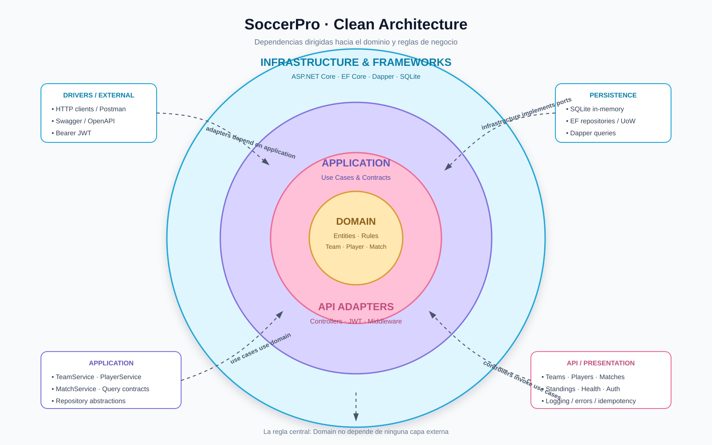

# SoccerPro

API REST de torneo de fútbol construida con .NET 10, Clean Architecture y CQRS.



## Casos de uso

Segun el contexto de SoccerPro, los casos de uso principales son:

- Autenticar usuarios mediante un token JWT.
- Crear, consultar, actualizar y eliminar equipos.
- Crear, consultar, actualizar y eliminar jugadores asociados a un equipo.
- Programar, consultar, actualizar y eliminar partidos.
- Registrar el resultado de un partido.
- Consultar la tabla de posiciones, calculando partidos jugados, victorias, empates, derrotas, goles y puntos.

### Autenticación

## Estructura de la base de datos

La API utiliza SQLite en memoria. Las tablas se crean mediante `SoccerProDbContext` y se inicializan con datos de ejemplo al arrancar la aplicacion.

### Teams

| Propiedad | Tipo | Descripcion |
|---|---|---|
| `Id` | `GUID` | Identificador unico y clave primaria. |
| `Name` | `TEXT` | Nombre obligatorio del equipo. Tiene un indice unico. |
| `City` | `TEXT` nullable | Ciudad del equipo. Puede no informarse. |
| `CreatedAt` | `DATETIMEOFFSET` | Fecha y hora UTC de creacion. Se asigna automaticamente. |
| `ModifiedAt` | `DATETIMEOFFSET` nullable | Ultima fecha de actualizacion. Es `null` al crear y se establece al ejecutar `PUT`. |

### Players

| Propiedad | Tipo | Descripcion |
|---|---|---|
| `Id` | `GUID` | Identificador unico y clave primaria. |
| `TeamId` | `GUID` | Identificador del equipo al que pertenece el jugador. |
| `Name` | `TEXT` | Nombre obligatorio del jugador. |
| `Position` | `TEXT` | Posicion del jugador, por ejemplo `Goalkeeper` o `Forward`. |
| `CreatedAt` | `DATETIMEOFFSET` | Fecha y hora UTC de creacion. |
| `ModifiedAt` | `DATETIMEOFFSET` nullable | Ultima fecha de actualizacion. Es `null` al crear y se establece al ejecutar `PUT`. |

### Matches

| Propiedad | Tipo | Descripcion |
|---|---|---|
| `Id` | `GUID` | Identificador unico y clave primaria. |
| `HomeTeamId` | `GUID` | Identificador del equipo local. |
| `AwayTeamId` | `GUID` | Identificador del equipo visitante. Debe ser diferente de `HomeTeamId`. |
| `ScheduledAt` | `DATETIMEOFFSET` | Fecha y hora programada del partido. |
| `HomeScore` | `INTEGER` nullable | Goles del equipo local. Es `null` mientras no exista resultado. |
| `AwayScore` | `INTEGER` nullable | Goles del equipo visitante. Es `null` mientras no exista resultado. |
| `CreatedAt` | `DATETIMEOFFSET` | Fecha y hora UTC de creacion. |
| `ModifiedAt` | `DATETIMEOFFSET` nullable | Ultima actualizacion, incluido `PATCH /api/matches/{id}/result`. Es `null` al crear. |

### IdempotencyRecords

Guarda la respuesta de solicitudes `POST` exitosas que incluyen `Idempotency-Key`, permitiendo devolver la misma respuesta en reintentos.

| Propiedad | Tipo | Descripcion |
|---|---|---|
| `Id` | `GUID` | Identificador unico y clave primaria. |
| `Key` | `TEXT` | Valor enviado en el encabezado `Idempotency-Key`. Tiene un indice unico. |
| `RequestHash` | `TEXT` | Hash SHA-256 generado por el middleware usando la ruta y el cuerpo de la solicitud. |
| `StatusCode` | `INTEGER` | Codigo HTTP de la respuesta original, por ejemplo `201`. |
| `ResponseBody` | `TEXT` | Cuerpo JSON de la respuesta original. |
| `Location` | `TEXT` nullable | Encabezado `Location`, cuando existe. |
| `CreatedAt` | `DATETIMEOFFSET` | Fecha y hora UTC en que se guardo la respuesta. |

Las operaciones `DELETE` realizan borrado fisico; las tablas no tienen una propiedad de borrado logico.

## Autenticacion

Todos los endpoints requieren un token JWT, excepto `POST /api/auth/token`. Usa las credenciales configuradas en `src/SoccerPro.Api/appsettings.json`:

```http
POST /api/auth/token
Content-Type: application/json

{"username":"<configured-user>","password":"<configured-password>"}
```

Envía el valor de `accessToken` como `Authorization: Bearer {accessToken}` en las solicitudes posteriores. En producción, reemplaza la llave y credenciales mediante secretos de configuración.

Ejecutar localmente: `dotnet run --project src/SoccerPro.Api`.
Ejecutar con Docker: `docker build -t soccerpro .` y `docker run -p 8080:8080 soccerpro`.
La colección y environment de Postman están en `postman/`.
